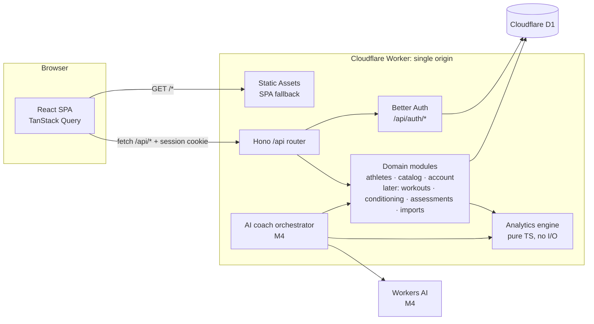

# System Architecture

## Overview



### Request pipeline (`apps/api/src/app.ts`)
1. `secureHeaders`, `Cache-Control: no-store`, a 64 KB body limit
2. A per-request `db` (Drizzle on D1) and `auth` (Better Auth). On Workers, bindings exist only per request.
3. `/api/auth/*` goes to Better Auth, which does its own origin checks and rate limiting. Session tokens are stripped from response bodies.
4. `originCheck`: unsafe methods must have `Origin === APP_ORIGIN` and a JSON content type.
5. Public `/api/catalog/*`
6. `loadSession`, then the private routes (`requireAuth`)
7. `onError` returns a safe JSON envelope. Logs contain the error name and message only, never bodies.

### Module conventions
Each module lives in `src/modules/<name>/` and contains:
- `*.routes.ts`: HTTP only (parse, call, respond)
- `*.repository.ts`: data access. **Every function takes the authenticated `userId` as its first argument and filters on it.**
- (M2+) `*.service.ts` when there is business logic beyond CRUD

Analytics (M3) will live in `packages/analytics` as pure functions with no database or HTTP imports. Repositories fetch rows, a mapper converts them to analytics inputs, and the engine returns structured results. The AI coach consumes those same results.

## Repository structure
```
apps/
  api/
    migrations/            drizzle-kit generated SQL, applied by wrangler
    src/
      app.ts               middleware + route wiring
      index.ts             Worker entry
      auth/                Better Auth config, session middleware, token stripping
      db/                  Drizzle client + schema (auth.ts, athletes.ts, …)
      lib/                 http helpers, origin check, mailer
      modules/             athletes/ catalog/ account/ (later: workouts/ …)
    test/                  workerd integration tests
    wrangler.jsonc
  web/
    public/_headers        CSP + security headers for static assets
    src/{components,lib,pages}/
    test/
packages/
  shared/                  Zod schemas, catalog, DTO types
  analytics/               (M3) deterministic calculations + fixtures
docs/
```

## Key decisions
| ADR | Decision |
|---|---|
| [0001](adr/0001-single-worker-same-origin.md) | One Worker serves both the SPA and the API on the same origin |
| [0002](adr/0002-better-auth-drizzle-d1.md) | Better Auth with the Drizzle adapter on D1; auth instance created per request |
| [0003](adr/0003-password-hashing-cpu.md) | Keep Better Auth's default scrypt hashing, which requires the Workers Paid plan |
| [0004](adr/0004-timestamps-and-units.md) | Integer-ms UTC timestamps; store original units alongside normalized values |

## AI unavailability
AI is an additive layer. Every page except the coach works without it, and the coach returns the structured analytics plus a "the explanation service is unavailable" message.
