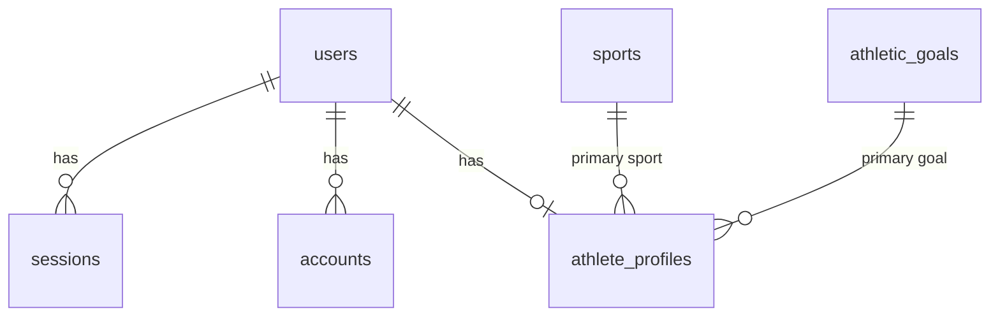
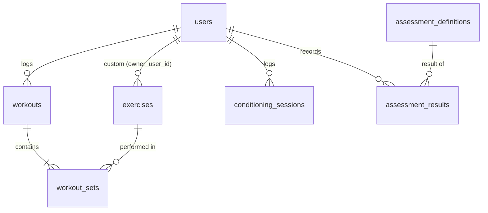

# Database Schema

D1 (SQLite), defined in `apps/api/src/db/schema/`. Migrations live in `apps/api/migrations/`. D1 enforces foreign keys, and deleting a user cascades to everything they own; a test verifies this.

Conventions: snake_case columns, text IDs (Better Auth generates random IDs), instants stored as integer ms UTC, training dates stored as `YYYY-MM-DD` text, and original units preserved ([ADR 0004](adr/0004-timestamps-and-units.md)).

## Implemented (M1)

| Table | Purpose | Notes |
|---|---|---|
| `users` | Better Auth user + registration attestations | `email` unique; `adult_confirmed`, `privacy_policy_version` |
| `sessions` | Server-side sessions | `token` unique; index on `user_id`; cascade |
| `accounts` | Credentials (password hash) per provider | never selected outside Better Auth; cascade |
| `verifications` | Reset and verification tokens | index on `identifier` |
| `rate_limits` | Auth rate-limit counters | `key` unique |
| `sports`, `athletic_goals` | Seeded reference data (slug PKs) | `is_active` instead of deleting rows; seed must match `packages/shared/src/catalog.ts` (tested) |
| `athlete_profiles` | One row per user (`user_id` PK) | sport, goal, unit preferences, `onboarding_completed_at`; CHECK constraints on units |

**Data minimisation:** no date of birth, sex, body mass or location. Age is an 18+ attestation, not a stored birthday.

## Implemented (M2)

Migrations `0003`–`0006`. Every athlete-owned table carries `user_id NOT NULL REFERENCES users ON DELETE CASCADE` (or owns its rows through a parent that does), and every query filters on it. Training dates are `YYYY-MM-DD` text with a `CHECK (date(x) IS x)` so impossible dates cannot be stored.

| Table | Key columns | Indexes / constraints |
|---|---|---|
| `exercises` | `id` (slug for global, UUID for custom), `owner_user_id NULL` (null = global catalog), `name`, `category` (squat/hinge/lunge/push/pull/jump/carry/other), `is_lower_body`, `archived_at NULL` | unique(`owner_user_id`, lower(`name`)); CHECK category. 37 global rows seeded from `EXERCISES` in the shared catalog (tested) |
| `workouts` | `id`, `user_id`, `workout_date`, `notes`, timestamps | (`user_id`, `workout_date`) |
| `workout_sets` | `id`, `workout_id` (cascade), `exercise_id` (no cascade), `set_index`, `reps`, `load_value`, `load_unit`, `load_kg`, `rpe NULL` | unique(`workout_id`, `set_index`); index (`exercise_id`); CHECK reps 1–100, rpe 1–10, load ≥ 0, unit kg/lb |
| `conditioning_sessions` | `id`, `user_id`, `session_date`, `type` (run/sprint/intervals/other), `duration_s`, `distance_value`/`distance_unit`/`distance_m` (all null or all set), `session_rpe` (CR-10, 0–10), `notes`, timestamps | (`user_id`, `session_date`); CHECKs on type, duration > 0, RPE, distance triple |
| `assessment_definitions` | `id` (`sprint_20m`, `vertical_jump`), `name`, `quality`, `canonical_unit`, `units` JSON, `better_direction` (lower/higher), `allowed_methods` JSON, `is_active` | seeded from `ASSESSMENT_DEFINITIONS` (tested) |
| `assessment_results` | `id`, `user_id`, `definition_id`, `assessed_on`, `value`, `unit` (s/cm/in), `value_canonical` (s or cm), `method`, `surface NULL`, `footwear NULL`, `conditions_note NULL`, `notes NULL`, timestamps | (`user_id`, `definition_id`, `assessed_on`), (`user_id`, `assessed_on`); CHECK value > 0, unit |

Rules enforced in the API rather than the schema (they live in `packages/shared` so the web forms apply the same ones): each definition only accepts its own units and methods (sprint: hand timing, timing gates, video app, other; jump: jump mat, force plate, video app, wall/Vertec reach, other), and canonical values must fall in a plausible range (sprint 2–10 s, jump 5–150 cm) to catch unit typos. Surface and footwear are fixed lists (`ASSESSMENT_SURFACES`, `ASSESSMENT_FOOTWEAR`).

### M2 decisions
- **Custom exercises are archived, not deleted, once used.** `DELETE /exercises/:id` tries a delete; the `workout_sets.exercise_id` foreign key refuses it when sets reference the exercise, and the row gets `archived_at` instead. Archived exercises leave the picker but keep their name in history, and re-creating the same name restores them.
- **Custom names may not shadow global ones.** NULL owners are distinct in a SQLite unique index, so the global-name check is in the repository.
- **Canonical columns are computed on write** by `packages/shared/src/units.ts` (`load_kg`, `distance_m`, `value_canonical`) and are never accepted from the client.
- **`import_job_id` is not added yet.** M3 adds it with `import_jobs`; SQLite allows `ADD COLUMN … REFERENCES` when the default is NULL, so no table rebuild is needed.
- **No time-zone handling.** Dates are stored as the athlete entered them; the API rejects dates after tomorrow in UTC, which allows "today" in every time zone.

## Planned (M3–M4)

| Table | Key columns | Indexes / constraints |
|---|---|---|
| `import_jobs` | `id`, `user_id`, `kind`, `file_sha256`, `status`, `row_count`, `accepted`, `rejected`, `created_at`, `confirmed_at` | unique(`user_id`, `file_sha256`) catches duplicate files |
| `import_row_errors` | `import_job_id`, `row_number`, `field`, `message` | no raw row values stored |
| `ai_usage` | `id`, `user_id`, `created_at`, `model`, `input_tokens`, `output_tokens`, `tools_called`, `status` | (`user_id`, `created_at`); no prompt text stored |
| `evidence_references` | `id`, `title`, `authors`, `year`, `doi_or_url`, `findings`, `limitations`, `qualities` JSON, `reviewed_at` | global, curated by hand |

### Why these choices
- **Normalized `workout_sets` instead of JSON:** volume, e1RM and PR queries need per-set rows.
- **`*_canonical` / `*_kg` columns:** analytics never convert units on the fly, and original values are kept for audit and export.
- **`method` and conditions on every assessment:** a hand-timed sprint and a gate-timed sprint are not comparable. The engine flags comparisons across different methods instead of hiding them.
- **`import_job_id` on records:** provenance, plus "undo this import".
