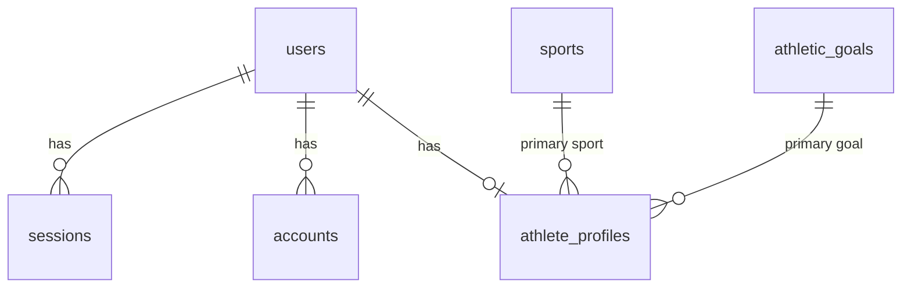

# Database Schema

D1 (SQLite), defined in `apps/api/src/db/schema/`. Migrations live in `apps/api/migrations/`. D1 enforces foreign keys, and deleting a user cascades to everything they own; a test verifies this.

Conventions: snake_case columns, text IDs (Better Auth generates random IDs), instants stored as integer ms UTC, training dates stored as `YYYY-MM-DD` text, and original units preserved ([ADR 0004](adr/0004-timestamps-and-units.md)).

## Implemented (M1)

| Table | Purpose | Notes |
|---|---|---|
| `users` | Better Auth user + registration attestations | `email` unique; `adult_confirmed`, `privacy_policy_version` |
| `sessions` | Server-side sessions | `token` unique; index on `user_id`; cascade |
| `accounts` | Credentials (password hash) per provider | never selected outside Better Auth; cascade |
| `verifications` | Reset and verification tokens | index on `identifier` |
| `rate_limits` | Auth rate-limit counters | `key` unique |
| `sports`, `athletic_goals` | Seeded reference data (slug PKs) | `is_active` instead of deleting rows; seed must match `packages/shared/src/catalog.ts` (tested) |
| `athlete_profiles` | One row per user (`user_id` PK) | sport, goal, unit preferences, `onboarding_completed_at`; CHECK constraints on units |

**Data minimisation:** no date of birth, sex, body mass or location. Age is an 18+ attestation, not a stored birthday.

## Planned (M2–M4)

All athlete-owned tables carry `user_id NOT NULL REFERENCES users ON DELETE CASCADE`, and every query filters on it.

| Table | Key columns | Indexes / constraints |
|---|---|---|
| `exercises` | `id`, `name`, `category` (squat/hinge/…), `is_lower_body`, `owner_user_id NULL` (null = global catalog) | unique(`owner_user_id`, lower(`name`)) |
| `workouts` | `id`, `user_id`, `workout_date` (text), `notes`, `import_job_id NULL` | (`user_id`, `workout_date`) |
| `workout_sets` | `id`, `workout_id`, `exercise_id`, `set_index`, `reps`, `load_value`, `load_unit`, `load_kg`, `rpe NULL` | CHECK reps 1–100, rpe 1–10, load ≥ 0; index (`exercise_id`) |
| `conditioning_sessions` | `id`, `user_id`, `session_date`, `type` (run/sprint/intervals/other), `duration_s`, `distance_value/unit NULL`, `distance_m NULL`, `session_rpe` (CR-10), `notes` | (`user_id`, `session_date`) |
| `assessment_definitions` | `id` (slug: `sprint_20m`, `vertical_jump`), `name`, `quality`, `canonical_unit`, `better_direction` (lower/higher), `allowed_methods` JSON | seeded |
| `assessment_results` | `id`, `user_id`, `definition_id`, `assessed_on`, `value`, `unit`, `value_canonical`, `method` (hand-timed/timing-gates/app/jump-mat/…), `surface`, `footwear`, `conditions_note`, `notes`, `import_job_id NULL` | (`user_id`, `definition_id`, `assessed_on`) |
| `import_jobs` | `id`, `user_id`, `kind`, `file_sha256`, `status`, `row_count`, `accepted`, `rejected`, `created_at`, `confirmed_at` | unique(`user_id`, `file_sha256`) catches duplicate files |
| `import_row_errors` | `import_job_id`, `row_number`, `field`, `message` | no raw row values stored |
| `ai_usage` | `id`, `user_id`, `created_at`, `model`, `input_tokens`, `output_tokens`, `tools_called`, `status` | (`user_id`, `created_at`); no prompt text stored |
| `evidence_references` | `id`, `title`, `authors`, `year`, `doi_or_url`, `findings`, `limitations`, `qualities` JSON, `reviewed_at` | global, curated by hand |

### Why these choices
- **Normalized `workout_sets` instead of JSON:** volume, e1RM and PR queries need per-set rows.
- **`*_canonical` / `*_kg` columns:** analytics never convert units on the fly, and original values are kept for audit and export.
- **`method` and conditions on every assessment:** a hand-timed sprint and a gate-timed sprint are not comparable. The engine flags comparisons across different methods instead of hiding them.
- **`import_job_id` on records:** provenance, plus "undo this import".
